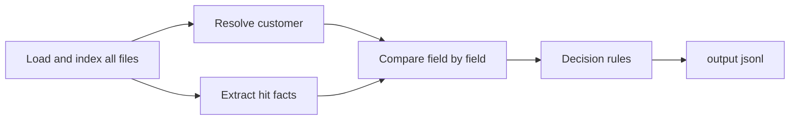

# grok_fin_hack: "Is my customer sanctioned?"

Grok Bot London Financial Crime Hackathon, Saturday 21 November 2026. Track 2: Sanctions screening (designed by Diligent).

For every sanctions, PEP or adverse-media hit raised against a customer, decide whether the hit is the customer (`SAME_ENTITY`), a different person or company (`DIFFERENT_ENTITY`), or needs a person to review it (`REVIEW`).

**Code freeze is at 17:00.** Submit through the portal by then.

## Final version at a glance

- **Entry point:** `system/run <data folder> <output file>`. Python 3 standard library only, no model calls, about 18 s for the 819 dev hits, byte-identical from run to run. Architecture, evidence rules and example cases: [`system/README.md`](system/README.md).
- **Practice labels:** 50/50 right, 0 unsafe clearances, reason codes and customer records 100%, evidence equal to the reference on 50/50.
- **Grok red team:** [`tools/grok_redteam.py`](tools/grok_redteam.py) has Grok (`x-ai/grok-4.7`) rewrite the free text the system reads; it found 27 unsafe misreadings and one real wrong clearance on dev, all fixed, with a person approving every vocabulary change. Grok never decides a hit.
- **Dashboards** (demo, not part of the scored run): [review dashboard](https://bizwizone-cyber.github.io/grok_fin_hack/dashboard/index.html) for analysts (review queue, analyst decisions, Tavily research), and [test results](https://bizwizone-cyber.github.io/grok_fin_hack/dashboard/tests.html) comparing versions on every test (practice labels, a 10,000-hit synthetic benchmark, the red team).
- **Safety regressions:** `python3 system/test_safety_regressions.py`.

---

## Task list

### Setup (by 12:30)
- [x] Download the Track 2 dataset and unzip it locally into `dev/`. Never commit it.
- [x] Read `POLICY.md` and copy the real reason codes into the `REASON_CODES` table in `system/run`
- [x] Look through `practice_labels.jsonl` (50 answered hits) and note the route through the files for each type of case
- [x] Map the real field names in `system/run`, which are kept in one section
- [x] Baseline: run `validate.py` on a "send everything to REVIEW" output. It should score 0.

### Who is the customer? (12:30 to 14:00)
- [x] Follow the alert link (account, login or email) through `accounts` to `customers`, including duplicate or old records
- [x] Follow `onboarding` to `kyc_checks` and use **only checks that passed**. Verified details beat declared ones.
- [x] Use `notes` (filed by email) for previous addresses and other context
- [x] Group candidate records into distinct people by verified date of birth plus name, **not** by phone or address
- [x] If more than one person fits, set `customer_record_id = AMBIGUOUS`. Still clear the hit if every candidate contradicts it.

### Who is the listed person? (14:00 to 15:00)
- [x] Take the structured fields: dates of birth, aliases, countries, entity type, deceased
- [x] Parse ages from profile notes, e.g. "aged 45 when sentenced in March 2019", which gives a birth year of 1973 or 1974
- [x] Pull "born", "died" and "incorporated" years from free text
- [x] Use `search_results` only when a result is clearly about this listed person, since most are about namesakes

### Decisions (15:00 to 16:15)
- [ ] 15:00: show progress to the mentors at office hours
- [x] Write the rule order (see below) and use the Splink-style field comparisons
- [x] Reason text built from this hit's own facts, stating what's missing
- [x] Evidence lists **only** the record IDs that decided the hit
- [x] Score against the practice labels with `validate.py --score dev/practice_labels.jsonl` and fix any unsafe clearances first

### Finish (16:15 to 17:00)
- [x] Generate `output/dev.jsonl` with the system itself
- [x] Run it twice and diff the outputs to prove it's deterministic
- [x] Complete `system/README.md`: architecture diagram, resolution steps, evidence, determinism, run time, and three example cases (a mismatch, a match, a review)
- [x] Check `.gitignore` covers `dev/`, data and keys, then push the final commit
- [ ] Record the video demo
- [ ] Submit the repo link and project name through the [submission portal](https://gb-fincrime-hackathon-11-2026.teamdeel.workers.dev/submit)

### Stretch, only if there's time
- [x] An analyst review screen in Supabase, showing the REVIEW queue with reasons and evidence (for the demo only, not part of `system/run`)
- [x] Tavily lookup button in the review screen (demo only)

## Review dashboard (demo, not part of the scored run)

A Supabase-backed dashboard shows each run's alerts by date and time, the REVIEW queue, analyst reviews and optional
Tavily web research. [Open the live dashboard](https://bizwizone-cyber.github.io/grok_fin_hack/dashboard/index.html),
or see [`dashboard/README.md`](dashboard/README.md) for running it locally and loading new runs.

---

## Resources

| What | Link |
|---|---|
| Hackathon website | [gb-fincrime-hackathon-11-2026](https://gb-fincrime-hackathon-11-2026.teamdeel.workers.dev/hackathon) |
| Track 2 brief (Google Doc) | [Same Person or Not? Hackathon Brief](https://docs.google.com/document/d/1L0dvhyJ4JOLhOu0g3uOXGM_7UgwgZaDrfbWS7RwPX5I/edit?tab=t.0) |
| Dataset | "Get the dataset" button on the Track 2 card on the hackathon website (participants only) |
| Track 1 brief, for reference | [Transaction monitoring track](https://hosted-pages.godiligent.ai/hackathon-tm-track/) |
| Submission portal | [Submit](https://gb-fincrime-hackathon-11-2026.teamdeel.workers.dev/submit) |
| Event Discord (credits bot) | [Discord](https://discord.gg/dGk4swpts8) |
| Luma event page | [Luma](https://luma.com/spacexai-kpi9) |
| Repository | [bizwizone-cyber/grok_fin_hack](https://github.com/bizwizone-cyber/grok_fin_hack) |
| OpenRouter (the only model API allowed) | [OpenRouter docs](https://openrouter.ai/docs) |
| Splink (ideas only, can't be imported) | [moj-analytical-services/splink](https://github.com/moj-analytical-services/splink) |
| Grok Bot docs | [Get started](https://docs.x.ai/grok-bot/get-started) |
| Tavily docs | [docs.tavily.com](https://docs.tavily.com) |
| Supabase docs | [supabase.com/docs](https://supabase.com/docs) |
| Diligent | [godiligent.ai](https://www.godiligent.ai) |

## Key rules from the brief

- **Entry point:** `system/run <data folder> <output file>`, one JSON line per hit. Python 3 or Node standard libraries, or shell. **No pip packages.** Models only through OpenRouter, with the key in `OPENROUTER_API_KEY`. A run must take under 30 minutes.
- **Output fields:** `hit_id`, `alert_id`, `decision`, `reason_code`, `customer_record_id` (or `AMBIGUOUS`, or null), `reason` (2 to 4 sentences), `evidence` (the deciding record IDs).
- **Unknown stays unknown.** A missing field is not a mismatch, and a year-only birth date can still agree with a full date.
- **Verified beats declared.** A rejected KYC check is not evidence.
- **Build for the principles, not the files.** 80% of the score comes from about 550 unseen hits with new wording.
- **Don't commit `dev/` or the API key.** Only the last commit before the deadline is scored.

### Scoring

| Right answer | Said DIFFERENT | Said SAME | Said REVIEW |
|---|---|---|---|
| DIFFERENT_ENTITY | 0 | 3 | 3 |
| SAME_ENTITY | **60** (unsafe clearance) | 0 | 2 |
| REVIEW | **60** (unsafe clearance) | 2 | 0 |

Clear a hit only when you're about **95% sure**, since a wrong clearance costs 60 and a review costs 3. Overall: 80% unseen set, 10% dev set, 10% reproducibility (same decision and reason code across 5 runs). Decisions count for 75% of each set's score and reasons for 25%. Judges also look at execution, a working prototype, whether it solves the problem, creativity and UX.

---

## Architecture (team plan, with our changes)

One Python file, `system/run`, standard library only, **no model calls**, so it's fully deterministic.

### 1. Load and index everything in memory
Load every `.jsonl` file into dictionaries keyed by its join IDs: accounts by account ref, customers by id, email and login, onboarding by account ref, KYC checks by applicant id, notes by email, search results by name. About 250k small rows load in under a second.

### 2. Resolve the customer
- Look up matching customer records through the account ref, login or email.
- **Change:** group records into distinct people by **verified date of birth plus name**, not by phone. The brief warns that family members share phones and addresses.
- Use the most recent **passed** KYC check (ignore rejected or expired ones) for legal name, date of birth and document country. Fall back to declared fields if there's no passed check.
- **Change:** an `AMBIGUOUS` customer doesn't automatically mean REVIEW. If every candidate contradicts the hit, it can still be cleared.

### 3. Extract hit facts
- Structured fields: `countries`, `entity_type`, `dobs`, `aliases`.
- **Change:** derive birth years from age phrases ("aged 45 when sentenced in March 2019" gives 1973 or 1974), not just bare years.
- Keywords near years and dates: deceased, died, born, DOB, incorporated.
- **Change:** use years from search results only when the result clearly refers to this listed person.

### 4. Field-by-field comparison (Splink-inspired, standard library only)
- Compare name, date of birth, country and address separately and record each as evidence for or against a match.
- Jaro-Winkler name similarity, about 20 lines, alongside `name_variants.json`.
- A shared rare name counts for more than a common one, based on name frequency in `customers`.

### 5. Decision rules, in order
Normalise names first (lowercase, strip accents with `unicodedata`, drop punctuation and placeholders, apply `name_variants.json`).

1. **Entity type mismatch** (person vs company) → `DIFFERENT_ENTITY`
2. **Deceased** before the customer's activity → `DIFFERENT_ENTITY`
3. **Impossible timing** (customer under 16 at the listed event, or company incorporated after it) → `DIFFERENT_ENTITY`
4. **DOB contradicts every hit DOB or derived range** (more than 1 year apart, or same year with a different month or day) → `DIFFERENT_ENTITY`
5. **Verified legal name clearly different** after variants, e.g. a different surname, not a nickname or reordered name → `DIFFERENT_ENTITY`. **Change:** kept strict.
6. **Ambiguous customer and no rule above cleared every candidate** → `REVIEW`
7. **Name and DOB match** (person) or **name and country or registration match** (company), with no contradiction → `SAME_ENTITY`
8. **Everything else** → `REVIEW`

**Correction:** `POLICY.md` principle 6 *does* clear a hit when every country tied to the customer differs from every country tied to the hit (`LOCATION_MISMATCH`), unless name and date of birth agree, which makes it `REVIEW`. `system/run` follows the policy. As a safety valve, a country value the system cannot read blocks a location clearance (the hit goes to `REVIEW`).

Reason codes above are descriptions. **Use the exact codes from `POLICY.md`.**
