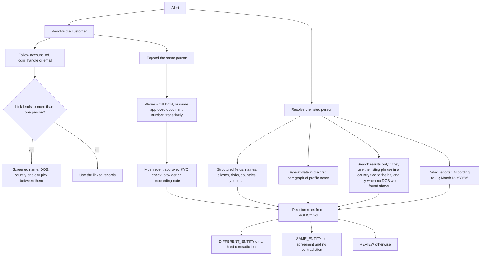

# Screening entity resolution

`system/run` is a single Python 3 executable. It uses only the standard library and makes no model calls. Decisions follow `POLICY.md` exactly and are deterministic.

```
system/run <data_folder> <output_file>
```

A run on the development set (819 hits, ~250k supporting rows) takes about **15–20 seconds** on an Apple M5 laptop (up to about a minute on slower machines) and costs **$0**.

## Architecture



The comparison is Splink-inspired and stdlib-only: each field (name, date of birth, country and entity type) becomes an explicit `agree`, `contradict` or `unknown` comparison level. A small fixed-weight Fellegi–Sunter-style score then gates confirmations: DOB agreement is stronger than a name match and country agreement is corroboration. The score never authorises a clearance; only a hard contradiction in `POLICY.md` can do that. Name agreement itself uses the edit-distance and variant rules in principle 8, not a similarity score.

## How we find the customer

1. Follow whichever link the alert carries: `account_ref` → `accounts.account_id` (including joint holders), `login_handle` → `accounts.login_handle`, or `email` → `customers.email`.
2. If that link leads to more than one person, the screened name, date of birth, country and city pick between them (principle 2). Without a link, those same screened details are used to search the system of record. We never use another customer's records.
3. Records that share a phone number **and** the same full date of birth, or the same document number on approved identity checks, belong to one person, transitively (principle 3). A shared phone or address alone does not merge them.
4. The most recent **approved** identity check of that person supplies the verified legal name, date of birth and document country, whether it sits in `kyc_checks` or only in an onboarding note. Rejected and expired checks are ignored. A KYC-team note counts as a passed check unless it records a failure, so the failure wording is deliberately wide: rejected, failed, declined, inconclusive, on hold, awaiting, sent for review, resubmit, unreadable, expired or past expiry, suspected fraud or tampering, "could not verify", "did not match" and similar. Words that also appear in passed notes ("expiry 2031", "no signs of fraud") only count inside a phrase that states a failure. A failed check misread as passed could clear a real match, so this errs towards ignoring the note. Verified values beat declared ones.
5. Countries tied to the customer are residence and nationality on all of their records, the approved identity-document country, and places the notes say they lived. In free text a country name may be followed by any punctuation, so "passport (Bangladesh)" and "in Austria: 2008" both count.
6. If more than one person still fits the alert, we decide the hit for each. If they all lead to the same decision, we give it; otherwise the decision is `REVIEW` with `AMBIGUOUS_CUSTOMER_RECORD`. Either way `customer_record_id` is `AMBIGUOUS`. When one person has several records, any of them is accepted.

## How we find the listed person

- Names: `name`, aliases, and `best_matching_name`.
- Dates of birth: the `dobs` field; if it is empty, an age at a date in the **first paragraph** of `profile_notes` (someone aged 45 in March 2019 was born in 1973 or 1974); if still empty, web search results for the name. A search result is used only when it describes the same kind of listing in a country tied to the hit. The phrases are those in principle 5 ("a sanctioned individual", "a politically exposed person", and so on).
- Countries: `countries`, `nationality`, `citizenship`, the last part of each address, and `place_of_birth`. "International" and "Europe" are not countries. Codes and nationality adjectives map to the same country as the full name; territories stay their own country. Official long forms are listed whole, so "Korea, Democratic People's Republic of" is North Korea and "Virgin Islands, British" is the British Virgin Islands, not the United Kingdom.
- **Unreadable countries never clear a hit.** If either side has a country value the system cannot map (a spelling it has not seen), that value might be the country both share. The hit is then neither cleared nor confirmed on location; it goes to `REVIEW`, and the reason names the value that could not be read. Missing a country can only cost a review (3 points), never an unsafe clearance (60).
- Dated reports are exactly the lines `According to …; September 10, 2025: …` (day optional, as in `June 2014:`). Other wordings do not count.
- Date of death: `deceased_date`, or a death date written in the profile.
- For companies, only the `dobs` field is an incorporation date.

Name parts are compared as in principle 8: case, accents, punctuation and brackets are ignored; initials and placeholders are not parts; company legal forms from `name_variants.json` are not parts; two parts match if they are identical, share a variant group, are written together or apart, or differ by at most 1 edit (4–6 letters) or 2 edits (longer); names agree when at least two parts match, or every part of the shorter name matches. An individual customer whose name has fewer than two real parts is neither confirmed nor cleared on name.

## Evidence

`evidence` lists only the record IDs that decided the hit, as they appear in the files. Each ground cites the records behind its own fact:
- **`DOB_MISMATCH`, `NAME_MISMATCH_VERIFIED`:** the approved check (`KYC-…`) or onboarding note (`NOTE-…`) that gave the verified date of birth or name (or the customer record, for a declared date of birth), plus the search result (`SR-…`) that gave the hit's date of birth. If location would also clear the hit, its records are added.
- **`LOCATION_MISMATCH`:** every record that ties the customer to a country: customer records, the approved document, and lived-in notes.
- **Matches, and reviews where both sides share a country:** the source of the date of birth and only the records that tie the customer to the *shared* country.

On the 50 practice labels the evidence equals the reference evidence exactly on all 50 hits. The reason is two to four sentences that name this hit's own facts and, on `REVIEW`, what is missing.

## Determinism and models

- Hits are written in sorted `hit_id` order.
- Sets of records are sorted by ID. "Most recent" checks are ordered by date, then ID.
- There is no randomness and no clock. The only dates used are those in the data (for example `alerts.screened_at`).
- No language model and no OpenRouter call. There is no API cost, and a second run is byte-identical to the first (confirmed on the development set).
- The local comparison levels and fixed weights replace a dependency on Splink: there is no training pass, random seed, or external data. They can only keep an uncertain hit in `REVIEW`; they cannot turn it into `DIFFERENT_ENTITY`.

## Grok red team: hardening the readers against new wording

The unseen set words its free text differently, and every fact the system uses from free text comes through a handful of readers: KYC-team notes (passed or failed, name, date of birth), ages and deaths in hit profiles, and places a customer lived. `tools/grok_redteam.py` attacks exactly those readers. It is a development tool, not part of `system/run`, so the scored system still calls no model.

1. Grok (`x-ai/grok-4.7` through OpenRouter) writes new wordings of each kind of sentence, the way another vendor or analyst might, with placeholders instead of facts. Only invented people are used; no development data is sent.
2. Each wording is filled with invented people and ten date formats and run through the real reader functions in `system/run`.
3. Each reading is `ok`, `missed` (costs a review) or `WRONG` (a wrong fact, which can cause an unsafe clearance). WRONG readings are fixed first.
4. With `--suggest`, Grok proposes the vocabulary to add for each miss, quoting the words it relied on. A person approves each one before it goes into `system/run`; nothing is applied automatically, and nothing that would make a failed check read as passed is accepted.

The first round, run on 180 hand-written wordings (`tools/grok_redteam.py` without `--live`), found **27 WRONG readings**: failed checks read as passed ("bounced", "marked as 'refer'", "dropped out", "red flag"), the check date read as the birth date when the birth date was written `30.11.1985`, `1992/02/19` or `15th of July 1968`, and "KYC OK" read as the customer's name. It also found lived-in notes the system missed ("resident", "residential", "previous address", "relocated"). After the fixes there are **0 WRONG readings**. On the development set this changed one decision, `H-80FEC3`: the customer's note says "residential tenure in Pakistan … 2014 until 2022", so the Pakistani hit was wrongly cleared on location before and is now `REVIEW`.

The second round was live: Grok (`x-ai/grok-4.7`) wrote 60 new wordings, filled into 216 test sentences. Every passed and failed KYC note was read correctly and there were **0 WRONG readings**, but Grok found misses: places lived ("work history places the customer in…", "a posting in…", "time in … ran from"), ages ("was 47 when convicted", "47 years of age", "age given as 47") and deaths ("DOD", "Confirmed death of …"). Grok then proposed 40 vocabulary additions with the words it relied on. We accepted the ones that cannot cause a wrong clearance and rejected two that can: "death of" (a profile may say the person was involved in *someone else's* death) and "expired on" (documents expire too). After that round, places lived are read 48/48 and ages 33/36. Those wordings were already in the development set: four profiles say, for example, "Christian Zaum was 32 when arrested during September 2001", which the system could not read before. Two of those hits are now cleared on `DOB_MISMATCH` (customer born 1995), one is confirmed (`H-2EBD19`, born 1955 against 1955 or 1956), and one gains a stronger ground.

The red team reruns without cost: `--cached` re-tests the last Grok wordings after every code change.

In production the same loop would run on every batch of analyst-reviewed alerts: the wordings that reached a person become the next round's test sentences, and the approved vocabulary grows with each round.

## Three example cases

### A clear mismatch — `H-13E1CF` (`TEMPORAL_IMPOSSIBILITY`)

The customer, Abdul Rahman Yasin (`CUS-364225`, with a second record `CUS-851234` of the same person), has a verified date of birth of 2007-08-21 (`KYC-358C76`). The listed profile's earliest dated report is "According to the thenews.com.pk; January 08, 2020: …". He was at most 12 at that date, so the hit is a different person.

### A match — `H-582410` (`NAME_DOB_LOCATION_MATCH`)

The alert's account has two joint holders; the screened name and date of birth fit `CUS-377745`, Elvira Velasco Morillo. An onboarding note (`NOTE-14E25A`) verifies her date of birth as 1968-03-05. The listed profile gives birth years 1967 or 1968 (from "a 30-year-old" in November 1998). Name and date of birth agree, both sides are linked to Spain, and nothing contradicts them.

### Left for review — `H-CDEC83` (`INSUFFICIENT_DATA`, `customer_record_id` `AMBIGUOUS`)

No alert link. A search on the screened name, year of birth and country finds two people (records `CUS-037213`, `CUS-565167`, `CUS-892985`). Decided separately, each leads to the same outcome: the name agrees with Juan González and both sides are linked to Panama, but the hit has no usable date of birth, so the hit can be neither cleared nor confirmed. Because every person gives the same decision, that decision is returned, with `customer_record_id` `AMBIGUOUS`.

## How to score locally

```
system/run dev output/dev.jsonl
python3 validate.py --data dev --output output/dev.jsonl --score dev/practice_labels.jsonl
```

On the 50 practice labels this system scores **100.0**, with **0 unsafe clearances**, and every right decision has an accepted reason code and customer record.
